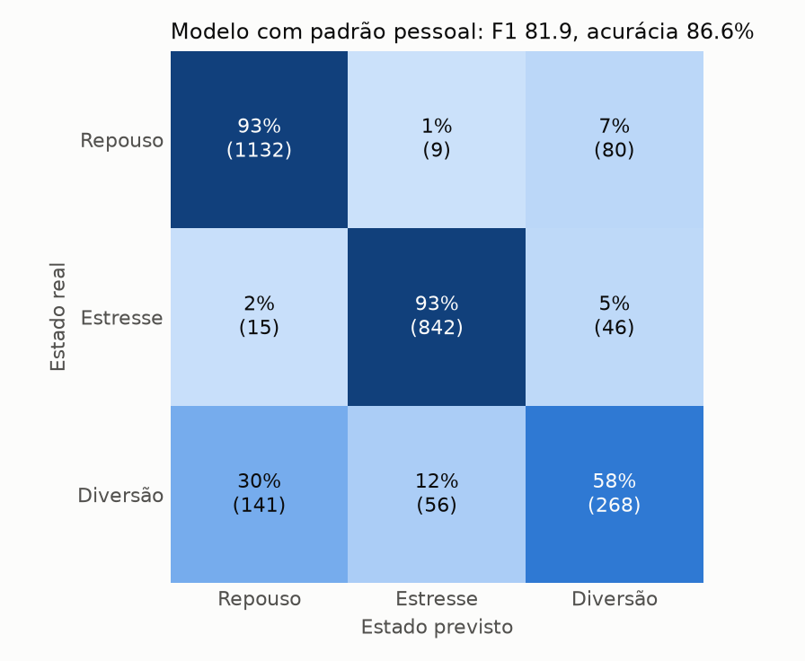
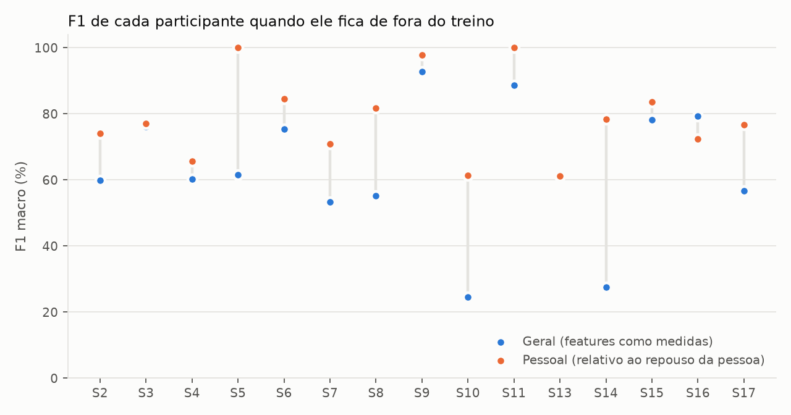
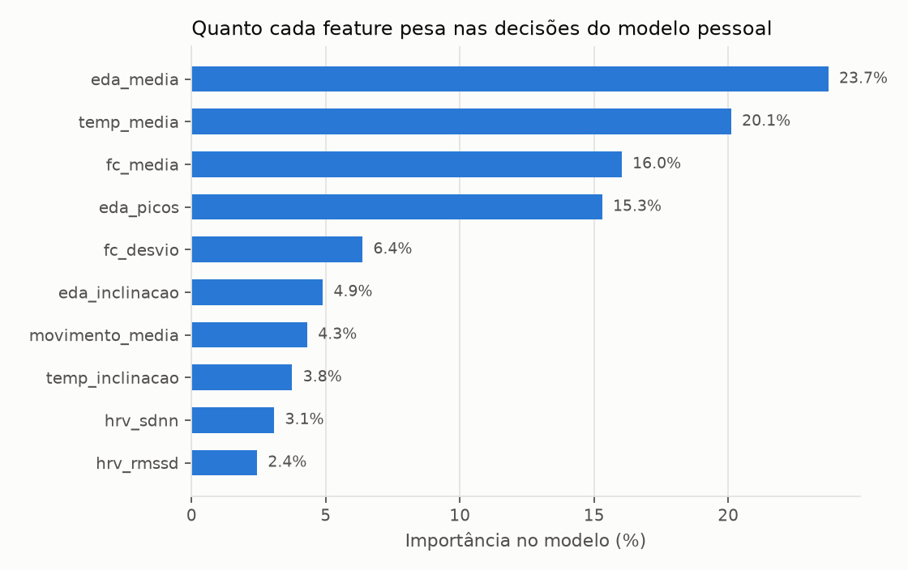
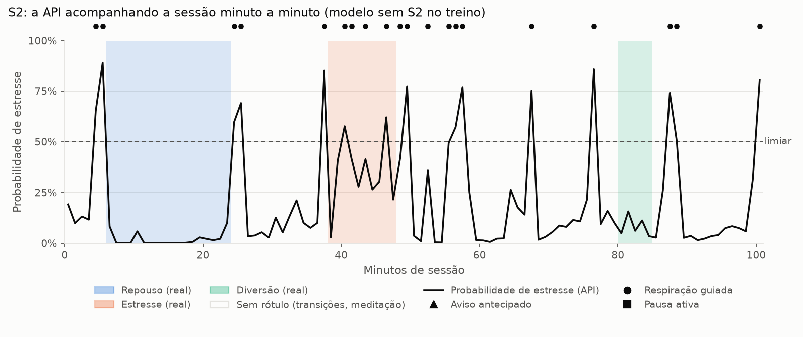
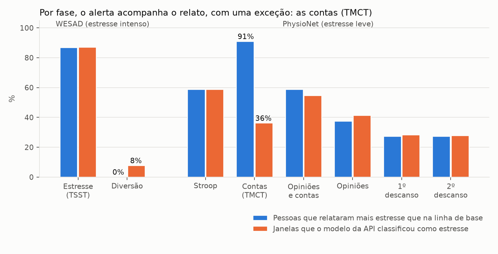

# Inteligência Artificial: do sinal do pulso ao alerta

Material da parte de IA para o relatório técnico. Cobre as seções **Desenvolvimento e Funcionalidades** (parte de IA) e **Análise de Resultados**. Todos os números vêm dos arquivos desta pasta (`metricas.json`, `simulacao_api.json`, `simulacao_api_janelas.csv`, `comparacao_bases.json`, `o_que_e_estresse.json`) e podem ser reproduzidos com os comandos do final.

**Resumo.** O sistema identifica estresse a partir de quatro sinais de uma pulseira (pulso, condutância da pele, temperatura e movimento). Comparando cada pessoa com o próprio repouso, o modelo acerta **86,6%** das janelas de 1 minuto entre repouso, estresse e diversão (**F1 81,9**), contra F1 de 64,1 do artigo original do dataset. Na simulação de uso real pela API, **todos os 15 participantes** receberam alerta durante o estresse, com **1,7 alertas falsos por hora** em repouso e diversão e **28 ms** por resposta, graças a uma regra que só alerta após 2 minutos seguidos de estresse. O Random Forest foi comparado com outros seis modelos e ficou entre os melhores. A principal limitação aparece fora das condições do experimento: em transições e questionários, o modelo ainda alerta com frequência (17 por hora). Uma **segunda base pública** (PhysioNet, 33 participantes, com sessões de exercício) confirmou e mediu esse limite: o modelo generaliza mal para outro estudo (F1 do estresse 37,8) e chama **91% dos minutos de exercício** de estresse. Ensinar o que é exercício resolve esse erro, mas derruba a detecção do estresse intenso do WESAD; só com sinais do pulso, os dois são parecidos demais. Uma **terceira base** (Stress-Predict, 34 participantes) mostrou que juntar estudos não basta: treinado em duas bases e testado numa terceira, o modelo não supera a melhor base isolada, porque cada estudo chama de estresse coisas diferentes. Comparando com o que os participantes disseram sentir, o modelo segue a **ativação do corpo**, não o estresse sentido: no estresse intenso as duas coisas coincidem, no leve não.

---

## 1. O que foi desenvolvido

A parte de IA transforma um minuto de sinais brutos numa decisão, em cinco etapas:

1. **Janela:** a ingestão junta 60 mensagens de 1 segundo vindas do simulador (`shared/features.py`, `juntar_mensagens`).
2. **Features:** os sinais da janela viram 10 números-resumo, como frequência cardíaca e picos de condutância da pele (`extrair_features`). O mesmo código roda no treino e ao vivo, para o modelo receber ao vivo exatamente o tipo de dado com que aprendeu.
3. **Modelo:** um Random Forest classifica a janela em repouso, estresse ou diversão (`treino/treinar.py`, servido por `api_ia/modelo.py`).
4. **Tendência:** a API guarda as últimas janelas de cada usuário e projeta a probabilidade de estresse do minuto seguinte (`api_ia/regras.py`).
5. **Intervenção:** regras simples escolhem o que sugerir ao usuário, e o alerta de estresse só sai após 2 minutos seguidos de estresse (`api_ia/regras.py`).

A API recebe as features em `POST /prever` e devolve estado, probabilidade, previsão do próximo minuto e intervenção, no formato definido em `contratos/api.py`.

## 2. Dados

Usamos o **WESAD** (Schmidt et al., 2018): 15 participantes com uma pulseira Empatica E4, em sessões de cerca de 100 minutos com condições rotuladas de repouso, estresse (falar em público e fazer contas sob avaliação) e diversão (vídeos engraçados).

- **Sinais usados (só os do pulso):** pulso óptico (BVP, 64 Hz), condutância da pele (EDA, 4 Hz), temperatura da pele (4 Hz) e acelerômetro (32 Hz). Escolhemos só o pulso porque é o que um relógio ou pulseira comercial mede.
- **Janelas:** 60 s, começando a cada 10 s, usando só as que ficam inteiras dentro de uma condição.
- **Total:** 3039 janelas (1671 de repouso, 903 de estresse e 465 de diversão). Apenas 1 janela foi descartada, por não ter batimentos detectáveis.

## 3. Features

| Feature | Sinal | O que mede | Unidade |
|---|---|---|---|
| `fc_media` | Pulso | Frequência cardíaca média | bpm |
| `fc_desvio` | Pulso | Quanto a frequência cardíaca varia na janela | bpm |
| `hrv_rmssd` | Pulso | Variabilidade entre batimentos seguidos | ms |
| `hrv_sdnn` | Pulso | Variabilidade geral dos intervalos entre batimentos | ms |
| `eda_media` | Condutância da pele | Nível médio de suor | µS |
| `eda_picos` | Condutância da pele | Número de respostas (picos de 0,01 µS ou mais) | contagem |
| `eda_inclinacao` | Condutância da pele | Tendência de subida ou descida | µS/min |
| `temp_media` | Temperatura | Temperatura média da pele | °C |
| `temp_inclinacao` | Temperatura | Tendência de subida ou descida | °C/min |
| `movimento_media` | Acelerômetro | Aceleração descontada a gravidade | g |

Os batimentos são encontrados filtrando o pulso na faixa de 40 a 200 bpm e localizando os picos com precisão menor que uma amostra; intervalos fora da faixa ou muito diferentes dos vizinhos (ruído) são descartados. Tudo é calculado só com `numpy` e `scipy`.

**As features respondem ao estresse como esperado** (medianas de todas as janelas):

| Feature | Repouso | Estresse | Diversão | Participantes em que o estresse supera o repouso |
|---|---|---|---|---|
| Frequência cardíaca (bpm) | 73,3 | **96,6** | 75,7 | **15 de 15** |
| Condutância média (µS) | 0,40 | **2,19** | 0,45 | **14 de 15** |
| Picos de condutância | 1 | **8** | 1 | **14 de 15** |
| Temperatura (°C) | 33,6 | 32,8 | 32,8 | 3 de 15 (cai no estresse em 12) |
| Variabilidade (RMSSD, ms) | 108,6 | 110,2 | 118,8 | 9 de 15 |

A variabilidade cardíaca medida no punho não separa as condições: no estresse do WESAD a pessoa fala e se mexe, e o movimento gera ruído no sinal de pulso.

## 4. Modelo e validação

- **Modelo:** Random Forest com 300 árvores, folhas de no mínimo 3 janelas e pesos que compensam o desequilíbrio entre as classes.
- **Validação leave-one-subject-out:** 15 rodadas; em cada uma, o modelo treina com 14 pessoas e é testado na que ficou de fora. Isso mede se o sistema funciona em alguém que ele nunca viu.
- **Padrão pessoal:** cada pessoa tem um "normal" diferente (frequência cardíaca de repouso, nível de suor). Por isso, os **primeiros 5 minutos de repouso** de cada participante servem de calibração, e cada feature passa a ser medida como **diferença em relação a esse repouso**. Essas janelas de calibração (375) e as que se sobrepõem a elas (75) ficam fora da avaliação, que usa as 2589 restantes.
- **Decisão no caminho:** a primeira versão também dividia pelo desvio padrão do repouso (z-score), e o F1 ficou em 69. Com só 5 minutos de calibração em janelas sobrepostas, esse desvio é pequeno e instável. Usar só a diferença elevou o F1 para 81,9.

## 5. Resultados por janela

| Modelo | F1 macro | Acurácia | F1 do estresse | Estresse x resto: acurácia |
|---|---|---|---|---|
| Referência: Schmidt et al. (2018), só pulso | 62,9 a 64,1 | 74,9 a 75,2 | — | — |
| Geral (features como medidas) | 67,8 | 73,7 | 85,5 | 89,7% |
| **Pessoal (relativo ao repouso)** | **81,9** | **86,6** | **93,0** | **95,1%** |

O modelo geral já supera a referência; o padrão pessoal acrescenta 14 pontos de F1. Por classe, o modelo pessoal tem F1 de 90,2 no repouso, 93,0 no estresse e 62,4 na diversão.



A matriz mostra onde o modelo erra: repouso e estresse são reconhecidos em 93% dos casos cada, e a maior confusão é a **diversão tomada por repouso** (30% das janelas de diversão), dois estados fisiologicamente parecidos. Para o sistema, isso importa pouco, porque o alerta depende de separar estresse do resto.



O padrão pessoal melhora o resultado em 13 dos 15 participantes, empata no S13 e piora só no S16. Ele ajuda mais justamente quem o modelo geral errava muito (S10 e S14). O F1 pessoal vai de 61 (S10, S13) a 100 (S5, S11), com média de 79 entre os participantes.



As decisões se apoiam sobretudo na condutância da pele (média e picos), na temperatura e na frequência cardíaca. A variabilidade cardíaca quase não pesa, coerente com a seção 3.

**Comparação com outros modelos** (`treino/comparar_modelos.py`, mesmo protocolo: padrão pessoal e leave-one-subject-out):

| Modelo | F1 macro | Acurácia | F1 do estresse | Pior participante |
|---|---|---|---|---|
| **Random Forest (escolhido)** | **81,9** | 86,6 | 93,0 | 61,2 |
| Random Forest, folha mínima 1 | 83,5 | 88,0 | 93,4 | 61,2 |
| Random Forest, folha mínima 10 | 82,1 | 86,3 | 93,2 | 61,2 |
| Extra Trees | 80,7 | 87,4 | 94,6 | 60,3 |
| Gradient Boosting (histograma) | 80,7 | 85,6 | 88,2 | 57,9 |
| Regressão logística | 72,1 | 75,3 | 89,4 | 48,6 |
| k vizinhos (k = 15) | 71,1 | 78,4 | 87,9 | 48,2 |

Os modelos baseados em árvores ficam entre 80,7 e 83,5 de F1, cerca de 10 pontos acima dos modelos linear e de vizinhos: as interações entre as features importam, o que justifica a escolha. Mantivemos o Random Forest com folha mínima 3: a melhor variação ganha só 1,6 ponto, e escolher o modelo pelo mesmo resultado de validação deixa essa diferença otimista, dentro do que pode ser acaso.

## 6. O sistema funcionando: resultados pela API

Os resultados da seção 5 avaliam janelas soltas. Para avaliar o **sistema**, simulamos o uso real (`treino/simular_api.py`): a sessão inteira de cada participante foi cortada em minutos seguidos e enviada, em ordem, para `POST /prever`, como a ingestão fará ao vivo. Cada participante foi simulado com um modelo treinado **sem ele**; dele, só entrou a calibração de 5 minutos.

| Medida | Resultado |
|---|---|
| Minutos enviados à API | 1442 (15 participantes), nenhum descartado |
| Acerto nos minutos com rótulo | 85,1% em média |
| Participantes que receberam alerta durante o estresse | **15 de 15** |
| Quando vem o primeiro alerta | Na mediana, já na **primeira janela inteira de estresse** (até cerca de 2 minutos após o início) |
| Minutos de estresse com alerta | 85,1% em média |
| Alertas falsos em repouso e diversão | 10 em 361 minutos: **1,7 por hora** |
| Alertas em trechos sem rótulo (transições, questionários, meditação) | 266 em 929 minutos: **17 por hora** |
| Tempo de resposta da API | **27,6 ms** na mediana, 29,6 ms no pior 5% (medido no próprio processo, sem rede) |

Esses números já incluem a **regra de confirmação** (seção 7): o alerta de estresse só sai após 2 minutos seguidos de estresse. Sem ela, os alertas falsos eram 2,5 por hora em repouso e diversão e 25 por hora nos trechos sem rótulo, com 89,8% do estresse coberto. A regra cortou cerca de um terço dos alarmes falsos e não atrasou o primeiro alerta na maioria dos participantes, porque o minuto anterior ao estresse muitas vezes já é classificado como estresse e serve de confirmação.



O gráfico mostra a sessão inteira do S2: as faixas coloridas são as condições reais, a linha é a probabilidade de estresse calculada pela API e os pontos no alto são as intervenções. No repouso, a probabilidade fica perto de zero; no estresse, sobe e oscila. Os picos nas faixas brancas são os alertas em trechos sem rótulo, discutidos na seção 10.

**Minuto a minuto, o início do estresse do S2** (dados reais da simulação):

| Minuto | Condição real | Estado previsto | Prob. de estresse | Intervenção |
|---|---|---|---|---|
| 36 | sem rótulo | diversão | 10% | nenhuma |
| 37 | sem rótulo (transição para o estresse) | estresse | 85% | nenhuma (aguarda confirmação) |
| 38 | estresse | diversão | 3% | nenhuma |
| 39 | estresse | diversão | 41% | nenhuma |
| 40 | estresse | estresse | 58% | nenhuma (aguarda confirmação) |
| 41 | estresse | estresse | 41% | **respiração guiada** |
| 42 | estresse | repouso | 28% | nenhuma |
| 43 | estresse | estresse | 41% | nenhuma (aguarda confirmação) |

O S2 é um caso difícil: a classificação oscila entre estresse, diversão e repouso, e a regra de confirmação só dispara quando há 2 minutos seguidos de estresse (minutos 40 e 41). Com isso, o primeiro alerta veio no 4º minuto da condição. Sem a regra, o pico isolado do minuto 37 teria gerado um alerta antes de a tarefa de estresse começar. O S2 está abaixo da média (F1 74, contra 79): em 13 dos 15 participantes, o primeiro alerta vem já no 1º minuto de estresse; no S9, no 3º.

## 7. Previsão do próximo minuto e intervenções

**Por que a previsão é por tendência.** O plano original era treinar um modelo para prever o estado do minuto seguinte. No WESAD, porém, **nenhum** dos 2318 pares de minutos seguidos muda de estado: as condições duram de 6 a 20 minutos, e as transições entre elas não têm rótulo válido. Um modelo dedicado empata com a regra "o próximo minuto será igual ao atual" (F1 82,1 nos dois). Por isso, a API projeta a probabilidade de estresse a partir das 3 últimas janelas do usuário (tendência linear) e, se a projeção passa de 50%, prevê estresse.

**Regras de intervenção** (da mais leve à mais forte):

| Situação | Intervenção |
|---|---|
| Sem estresse e sem tendência de subida | nenhuma |
| Sem estresse agora, mas a projeção do próximo minuto passa de 50% | **aviso antecipado** |
| Estresse em 1 minuto só | nenhuma (aguarda confirmação: evita alarme por um pico isolado) |
| Estresse por 2 minutos seguidos | **respiração guiada** (2 a 3 minutos, cerca de 6 respirações por minuto) |
| Estresse por 10 minutos seguidos | **pausa ativa** |

A regra de confirmação foi escolhida comparando, na simulação da seção 6, seis formas de decidir o alerta: alertar a cada minuto, 2 minutos seguidos, 2 dos últimos 3 minutos e médias móveis da probabilidade com limiares diferentes. "2 minutos seguidos" foi a única que reduziu os alarmes falsos mantendo o alerta para os 15 participantes; as médias móveis que reduziam tanto quanto ela deixavam 2 participantes sem alerta no estresse.

Duas intervenções da proposta ficam fora da API: o **ajuste do ambiente** depende do ruído e da temperatura da sala, e o **encaminhamento** a um profissional depende de um padrão de vários dias. Nenhum dos dois chega à API por janela; podem ficar no dashboard.

## 8. Validação com outras bases

Todos os resultados anteriores vêm do WESAD. Para não depender de uma única base, testamos o sistema numa segunda base pública com a **mesma pulseira**: o *Wearable Device Dataset from Induced Stress and Structured Exercise Sessions* (Hongn et al., 2025, PhysioNet). Ela tem duas coisas que o WESAD não tem: **outro protocolo de estresse**, com outras pessoas, e **sessões de exercício** em bicicleta ergométrica (contínuo e em sprints).

**Preparação** (`treino/preparar_physionet.py`). As fases do protocolo são marcadas por toques no botão da pulseira; usamos o mapeamento do notebook dos autores:

- **repouso:** linha de base e os dois descansos;
- **estresse:** teste de Stroop, aritmética mental (TMCT) e o bloco de tarefas de opinião e contas. Cada tarefa desse bloco dura só 30 a 40 s, menos que uma janela, então o bloco foi tratado como contínuo (suposição nossa);
- **exercício:** as sessões de bicicleta, do primeiro ao último toque;
- **calibração do padrão pessoal:** a linha de base, de 1,5 a 3 minutos (no WESAD, 5 minutos).

Ficaram de fora os registros com problema documentado pelos autores (sinais duplicados, sensor coberto, sessões divididas). Resultado: **35 participantes e 12 007 janelas** (3652 de repouso, 863 de estresse e 7492 de exercício); 33 participantes têm calibração e entram nos experimentos.

O estresse desta base é **mais leve** que o do WESAD. No relato dos próprios participantes (escala de 1 a 10), o TMCT tem média 6,4 contra 2,4 a 2,6 nos descansos (protocolo versão 2), mas na versão 1 o Stroop tem 4,0 contra 3,4 na linha de base. E o exercício, para os sinais do pulso, parece um estresse extremo:

| Mediana | Repouso | Estresse | Exercício |
|---|---|---|---|
| Frequência cardíaca (bpm) | 76,5 | 84,8 | **118,9** |
| Condutância média (µS) | 0,51 | 1,04 | **4,92** |
| Picos de condutância | 1 | 7 | **14** |
| Movimento do punho (g) | 0,01 | 0,02 | 0,04 |

Na bicicleta, o punho fica apoiado no guidão: o acelerômetro quase não distingue o exercício.

**Experimentos** (`treino/avaliar_bases.py`, todos com o padrão pessoal, medindo estresse contra o resto):

| Experimento | F1 do estresse | Observação |
|---|---|---|
| Treino e teste no WESAD (leave-one-subject-out) | **93,0** | o resultado da seção 5 |
| **Treino no WESAD, teste no PhysioNet** | **37,8** | acurácia balanceada 60,4; AUC 0,63 |
| Treino no PhysioNet, teste no WESAD | 63,5 | acurácia balanceada 69,7; AUC 0,77 |
| **Modelo do WESAD diante do exercício** | — | **91% dos minutos de exercício viram "estresse"** |
| Modelo combinado (WESAD + PhysioNet, com a classe exercício): exercício | — | só 5,6% viram estresse; 90% são reconhecidos como exercício |
| Modelo combinado: estresse do WESAD | **49,3** | 58% do estresse do WESAD passa a ser chamado de exercício |
| Modelo combinado: estresse do PhysioNet | 44,9 | |

**Meio-termo testado:** decidir o estresse sem a classe exercício e usar o exercício só para **suprimir o alerta** quando sua probabilidade passa de um limiar. Nenhum limiar resolve os dois problemas ao mesmo tempo:

| Limiar para suprimir | F1 do estresse (WESAD) | Exercício que vira estresse |
|---|---|---|
| Nunca suprime | 86,7 | 84,5% |
| 0,9 | 82,9 | 39,2% |
| 0,8 | 73,8 | 25,0% |
| 0,7 | 66,1 | 17,0% |
| 0,5 | 52,5 | 7,8% |

**O que aprendemos:**

1. **O resultado numa base só superestima o desempenho real.** O F1 de 93 cai para 38 quando o estresse vem de outro estudo, com outras pessoas e outro tipo de tarefa.
2. **Só com sinais do pulso, estresse intenso e exercício são parecidos demais.** Ensinar o exercício ao modelo resolve um erro e cria outro. A saída está no **contexto**: saber se a pessoa está se exercitando, pelo acelerômetro (caminhada e corrida movem o braço, ao contrário da bicicleta) ou por um "modo exercício" ativado pelo usuário ou pelo relógio, que suspende os alertas.
3. **Decisão para a demo:** a API continua com o modelo treinado só no WESAD, porque a demo reproduz sessões do WESAD. A segunda base fica como validação externa e como base para o trabalho futuro.

### 8.1 Terceira base: generalização entre estudos

Duas bases ainda não dizem se o problema é **falta de dados** ou **diferença entre estudos**. Para separar as duas coisas, acrescentamos uma terceira base com a mesma pulseira: o **Stress-Predict** (Iqbal et al., 2022), com 35 voluntários e outro protocolo de cerca de 1 hora: linha de base com questionários, **teste de Stroop, entrevista e hiperventilação**, com descansos entre as tarefas.

**Preparação** (`treino/preparar_stress_predict.py`). Os autores publicam um arquivo que marca cada segundo como estresse ou não; usamos esse arquivo, e não os toques no botão, porque os toques estão errados em quatro participantes e os rótulos dos autores foram corrigidos pela planilha de horários (conferimos um caso, o S06, contra a planilha). A **calibração** são os 5 minutos antes do Stroop; o começo da sessão inclui o termo de consentimento e a colocação da pulseira, então entra como repouso comum, sem calibrar. O S01 fica de fora (não tem rótulos). Resultado: **34 participantes e 9779 janelas** (6651 de repouso e 3128 de estresse).

O estresse desta base é **ainda mais leve** que o do PhysioNet, e os rótulos seguem o protocolo, não a fisiologia:

| Mediana | WESAD repouso | WESAD estresse | Stress-Predict repouso | Stress-Predict estresse |
|---|---|---|---|---|
| Frequência cardíaca (bpm) | 73,3 | **96,6** | 82,9 | 86,5 |
| Condutância média (µS) | 0,40 | **2,19** | 0,40 | 0,56 |
| Picos de condutância | 1 | **8** | 2 | 4 |

No Stress-Predict, a frequência cardíaca na linha de base (84,9 bpm) é maior que no Stroop (84,4), e a condutância no segundo descanso (0,74 µS) é igual à da entrevista (0,72): a pessoa ainda está se recuperando quando o rótulo já diz "repouso".

**Experimentos** (`treino/avaliar_bases.py`, perguntas 4 a 6; padrão pessoal, estresse contra o resto, sem a classe exercício). Na tabela, cada base é testada só com participantes que o modelo nunca viu:

| Treino | Teste: WESAD | Teste: PhysioNet | Teste: Stress-Predict |
|---|---|---|---|
| A própria base (leave-one-subject-out) | **93,0** | 56,2 | 59,2 |
| WESAD | — | 37,8 | 43,8 |
| PhysioNet | 63,5 | — | **58,3** |
| Stress-Predict | **67,1** | **46,9** | — |
| As outras duas juntas | 62,6 | 44,9 | 53,0 |
| As três juntas (leave-one-subject-out) | 78,7 | 49,5 | 57,9 |

*F1 do estresse. AUC dos testes em base nunca vista: de 0,59 (WESAD → Stress-Predict) a 0,79 (Stress-Predict → WESAD).*

O exercício do PhysioNet, que nenhum desses modelos viu no treino, vira "estresse" em **91%** dos minutos com o modelo do WESAD, **54%** com o do Stress-Predict e **68%** com os dois juntos.

**O que aprendemos:**

1. **O modelo do WESAD é o que pior generaliza** (F1 38 e 44 nas outras bases, AUC 0,59 a 0,63). Ele aprendeu um estresse intenso e fácil de ver (+23 bpm), que as outras bases não têm.
2. **Juntar bases não resolve sozinho.** Treinar nas outras duas juntas fica abaixo da melhor base isolada nos três testes, e o modelo com as três bases perde no WESAD (93,0 para 78,7) sem ganhar nas outras. O problema não é só quantidade de dados: cada estudo chama de "estresse" coisas diferentes (uma apresentação diante de avaliadores, um Stroop, uma hiperventilação).
3. **O teto das bases de estresse leve é baixo.** Mesmo dentro da própria base, o F1 fica em 56 a 59. Com rótulos por fase do protocolo, parte do "estresse" não aparece no pulso e parte do "repouso" ainda é recuperação. Qualquer base nova com o mesmo tipo de rótulo esbarra nesse limite.
4. **Treinar com estresse mais leve reduz o falso alarme no exercício** (91% para 54%), mas não o elimina: o contexto (seção 8, item 2) continua necessário.
5. **Decisão para a demo:** mantida. O modelo do WESAD é o melhor para a demo, que reproduz o WESAD; os resultados entre bases entram no relatório como a medida honesta de generalização.

## 9. O que o modelo chama de estresse?

Até aqui, "estresse" foi a **fase do protocolo**: o rótulo do treino. Mas há outras duas definições possíveis, e as bases permitem compará-las:

- **o relato:** depois de cada fase, os participantes disseram o que sentiram. No WESAD, o item *Stressed* do questionário PANAS (1 a 5), além do STAI curto (ansiedade, 20 a 80) e do SAM (ativação, 1 a 9). No PhysioNet, uma nota de estresse de 1 a 10 por fase. O Stress-Predict só tem questionários antes e depois da sessão inteira e fica de fora;
- **o corpo:** a mudança da frequência cardíaca e da condutância em relação à calibração da pessoa, e a probabilidade de estresse dada pelo modelo.

**Como foi medido** (`treino/analisar_estresse.py`). Para cada pessoa e fase: o relato, a diferença do relato para a linha de base, a reação média do corpo e a fração das janelas que o modelo da API classifica como estresse (probabilidade ≥ 0,5, sem a regra de confirmação). No WESAD, o modelo é avaliado com leave-one-subject-out; no PhysioNet, é o modelo treinado em todo o WESAD (o que a API faria com essas pessoas). As correlações comparam cada pessoa com ela mesma (Spearman depois de tirar a média de cada pessoa). A linha de base do PhysioNet é a calibração e por isso não tem janelas próprias.



**No WESAD, as três definições coincidem.** No estresse (TSST), 13 dos 15 participantes relataram mais estresse que na linha de base; na diversão, nenhum. A ansiedade (STAI) sobe de 36 na linha de base para 62 no estresse, e a ativação (SAM) de 2,5 para 6,8; na diversão, 31 e 3,0. Protocolo, relato, frequência cardíaca, condutância e modelo andam juntos (ρ entre 0,53 e 0,82, 45 fases). Por isso o F1 de 93 é possível nesta base.

**No PhysioNet, elas se separam.**

| Correlação dentro da pessoa (149 fases) | ρ |
|---|---|
| Protocolo × relato | 0,56 |
| Modelo da API × condutância | **0,56** |
| Modelo da API × frequência cardíaca | **0,53** |
| Modelo da API × protocolo | 0,36 |
| Modelo da API × relato | **0,22** |
| Frequência cardíaca × relato | 0,50 |
| Condutância × relato | 0,17 |

1. **O protocolo nem sempre é o que a pessoa sente.** Em um terço das fases "de estresse" (27 de 83), a pessoa relatou o mesmo ou menos estresse que na linha de base. Em 27% dos descansos (18 de 66), relatou mais.
2. **O modelo segue o corpo, não o relato.** A probabilidade de estresse acompanha a condutância e a frequência cardíaca (ρ 0,56 e 0,53), bem mais que o relato (0,22). Nas fases de estresse, o modelo marca estresse em **44%** das janelas quando a pessoa disse ter sentido estresse e em **48%** quando disse que não. Nos descansos, em 23% e 30%. Pessoa a pessoa, o alerta não distingue quem sentiu.
3. **A fase mais sentida é a menos detectada.** As contas mentais (TMCT) são a fase em que mais gente relatou estresse (91%), mas o corpo reage menos que no Stroop (frequência cardíaca +3,9 contra +6,5 bpm) e o modelo marca estresse em só 36% das janelas.
4. **O caso inverso também acontece.** No WESAD, os dois participantes que não relataram mais estresse no TSST (S6 e S9) foram também os de menor ansiedade no questionário (STAI 50 e 47, contra 57 a 73 dos outros). Mesmo assim, a condutância do S6 subiu 7,2 µS, e o modelo marcou estresse em 100% e 97% das janelas.

**O que isso significa para o sistema.** O que a pulseira mede é **ativação fisiológica**, não estresse sentido. No estresse intenso as duas coisas coincidem; no estresse leve, não. Isso muda três coisas:

- **A mensagem do alerta** deveria descrever o que foi medido e perguntar, e não afirmar: "notei uma ativação acima do seu normal; está tudo bem?", em vez de "você está estressado".
- **A resposta da pessoa é o rótulo que falta.** Guardar se o alerta fazia sentido daria, com o tempo, um rótulo ligado ao que a pessoa sente, para ajustar o limiar de cada um. Fica como trabalho futuro.
- **O F1 contra a fase do protocolo não mede tudo.** Parte dos "erros" do modelo nas bases de estresse leve é ativação real que a pessoa não chamou de estresse, e parte dos "acertos" é ativação sem estresse sentido.

**Cuidados.** O relato é um número por fase, dado depois da fase e numa escala diferente em cada base. As fases de uma mesma pessoa não são independentes, então as correlações são indicativas: mostramos ρ e o número de fases, sem teste de significância. No WESAD, os casos divergentes são só dois.

## 10. Limitações

1. **Alertas fora das condições do experimento.** O modelo só conhece repouso, estresse e diversão. Nas transições (andar entre salas, responder questionários) e na meditação, a fisiologia muda e o modelo alerta em 17 por hora, mesmo com a regra de confirmação (25 por hora sem ela). Parte disso pode ser ativação real (no S2, o pico do minuto 37 acontece logo antes do início do estresse rotulado), mas o WESAD não permite separar. A segunda base mostrou o caso extremo: **91% dos minutos de exercício viram alerta** (seção 8). Em uso real, onde a pessoa anda, sobe escadas e se exercita, esse é o principal risco.
   - **Ajuste aplicado:** só alertar após **2 minutos seguidos** de estresse (seção 7) reduziu os alertas em repouso e diversão de 2,5 para 1,7 por hora e, nos trechos sem rótulo, de 25 para 17 por hora. Todos os 15 continuam recebendo alerta, mas a parte do estresse coberta caiu de 90% para 85%. Regras mais elaboradas (médias móveis) não fizeram melhor: o limite agora está no modelo e no contexto, não na regra. Próximas saídas: o "modo exercício" e o reconhecimento de atividade pelo acelerômetro (seção 8).
2. **Generalização entre estudos:** treinado no WESAD e testado em outro estudo, o F1 do estresse cai de 93,0 para 37,8 (PhysioNet) e 43,8 (Stress-Predict). Com três bases e 82 participantes, juntar estudos não melhorou o teste em base nunca vista (seção 8.1): os estudos diferem no que chamam de estresse, e não só no tamanho. Um modelo de uso geral exigiria rótulos ligados à fisiologia ou ao relato da pessoa, e não só à fase do protocolo.
3. **Previsão do próximo minuto:** o dataset não tem transições rotuladas, então a previsão é uma regra de tendência, não um modelo treinado. E ela quase não antecipa nada: na simulação, o **aviso antecipado saiu só 9 vezes** em 1442 minutos (contra 229 respirações guiadas e 168 pausas ativas). A probabilidade de estresse costuma saltar de um minuto para o outro (em 10% das trocas, o salto passa de 44 pontos), cruzando o limiar antes que a tendência perceba a subida. Na prática, o sistema reage ao estresse no minuto em que ele aparece, não antes.
4. **Temperatura e tempo de sessão:** no WESAD, o estresse sempre vem depois do repouso, e a temperatura da pele cai ao longo da sessão (repouso 33,6 °C; estresse e diversão, que vêm depois, 32,8 °C). Parte do peso da temperatura no modelo pode ser "tempo de sessão", e não fisiologia.
5. **Variabilidade cardíaca no punho:** ruidosa demais para separar as condições (seção 3).
6. **Diversão:** confundida com repouso (F1 62).
7. **Calibração:** o modelo pessoal precisa de 5 minutos de repouso de cada usuário. Sem calibração, a API usa o modelo geral (F1 67,8).
8. **Ativação, não estresse sentido:** o modelo acompanha a reação do corpo (condutância e frequência cardíaca), não o que a pessoa diz sentir; no estresse leve, as duas coisas se separam (seção 9).
9. **Dados de laboratório:** as três bases são de laboratório, com estresse induzido. O desempenho em uso cotidiano tende a ser menor.

## 11. Como reproduzir

Na raiz do repositório, com o WESAD em `WESAD/` e as dependências de `treino/requirements.txt` instaladas:

```bash
python -m treino.preparar_wesad   # janelas e features do WESAD   (~20 s)
python -m treino.treinar          # validação, modelo e gráficos   (~20 s)
python -m treino.simular_api      # uso real simulado pela API     (~2 min)
python -m treino.comparar_modelos # comparação de modelos          (~45 s)
```

Para a segunda base, baixe o ZIP do PhysioNet (70 MB, link nas referências), descompacte numa pasta própria dentro de `data/` (fora do Git) e rode:

```bash
python -m treino.preparar_physionet --base <pasta descompactada>/Wearable_Dataset   # (~10 s)
python -m treino.avaliar_bases                                                       # (~2 min)
```

Para a terceira base, clone o repositório do Stress-Predict (116 MB) dentro de `data/` e rode antes do `avaliar_bases`:

```bash
git clone --depth 1 https://github.com/italha-d/Stress-Predict-Dataset.git data/stress_predict/repo
python -m treino.preparar_stress_predict                                             # (~10 s)
```

A análise da seção 9 usa o WESAD, o PhysioNet e os questionários das duas bases:

```bash
python -m treino.analisar_estresse --physionet-relatos <pasta descompactada do PhysioNet>   # (~20 s)
```

Tempos medidos num MacBook com Apple M3 Pro.

## Referências

- SCHMIDT, P.; REISS, A.; DUERICHEN, R.; MARBERGER, C.; VAN LAERHOVEN, K. Introducing WESAD, a multimodal dataset for wearable stress and affect detection. *Proceedings of the 20th ACM International Conference on Multimodal Interaction (ICMI)*, 2018. DOI: 10.1145/3242969.3242985.
- HONGN, A.; BOSCH, F.; PRADO, L.; BONOMINI, P. Wearable Device Dataset from Induced Stress and Structured Exercise Sessions (version 1.0.1). PhysioNet, 2025. DOI: 10.13026/he0v-tf17. Disponível em: https://physionet.org/content/wearable-device-dataset/1.0.1/. Licença Open Data Commons Attribution 1.0 (uso com atribuição).
- HONGN, A.; BOSCH, F.; PRADO, L. E.; FERRÁNDEZ, J. M.; BONOMINI, M. P. Wearable Physiological Signals under Acute Stress and Exercise Conditions. *Scientific Data*, v. 12, n. 1, 2025. DOI: 10.1038/s41597-025-04845-9.
- IQBAL, T.; SIMPKIN, A. J.; ROSHAN, D.; GLYNN, N.; KILLILEA, J.; WALSH, J.; MOLLOY, G.; GANLY, S.; RYMAN, H.; COEN, E.; ELAHI, A.; WIJNS, W.; SHAHZAD, A. Stress Monitoring Using Wearable Sensors: A Pilot Study and Stress-Predict Dataset. *Sensors*, v. 22, n. 21, 8135, 2022. DOI: 10.3390/s22218135. Dados: https://github.com/italha-d/Stress-Predict-Dataset (licença MIT).
- HAGOS, D. H.; ARYAL, S. K.; BURGE, L. L. From Stress to Affect: Multimodal Deep Learning for Physiological Emotion Recognition Across Wearable Sensor Modalities. arXiv:2609.20991, 2026. (Tabela VIII reproduz os resultados originais de Schmidt et al. usados como referência.)
